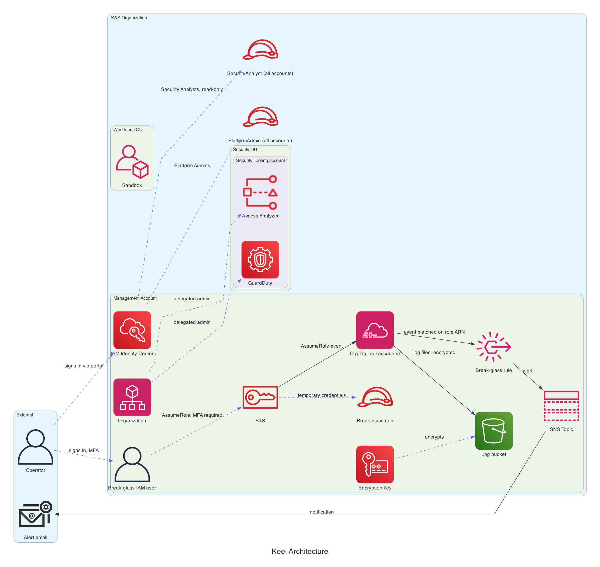

  <picture>
    <source media="(prefers-color-scheme: dark)" srcset="docs/images/keel-logo-dark.svg">
    
  </picture>

> [!NOTE]
> **Status**: Phase 2 in progress: IAM baseline and Config remaining.

Multi-account AWS Organization built in Terraform: preventative guardrails, centralized logging, and delegated detection. Controls are preventative wherever possible, detective where necessary, and deferred where they would generate noise without a remediation path.

Like a ship's keel, this AWS environment was laid first to keep everything built on top of it stable. 

## What this is

- **Multi-account environment**: The Management account runs the organization and identity; Security Tooling and Sandbox
  sit in separate Security and Workloads OUs, with Service Control Policies enforced at the OU level
- **Short-lived credentials as default path**: human access through IAM Identity Center; the one standing credential is MFA-gated, has no permissions at rest, and alarms on use
- **Org-wide visibility**: CloudTrail to a KMS-encrypted, versioned S3 bucket,
  GuardDuty delegated to the Security Tooling account, IAM Access Analyzer at
  the org level
- **Proven, not asserted**: controls marked "tested" have a documented test matrix, verified against expected responses

  

This is the current state after Phase 2.  Dashed lines represent access and trust relationships; solid lines are event and log flow.  Generated from [docs/diagrams/keel.py](/docs/diagrams/keel.py).

## Controls at a glance

| Control | Type | Status |
|---|---|---|
| SCP region containment | Preventative | Shipped, tested |
| SCP CloudTrail protection | Preventative | Shipped, tested |
| Org CloudTrail to KMS-encrypted S3 | Detective (logging) | Shipped, tested |
| GuardDuty, delegated admin | Detective | Shipped, enabled |
| IAM Access Analyzer, org level | Detective | Shipped, enabled |
| Identity Center, short-lived credentials for all routine access | Identity | Shipped, tested |
| Break-glass detection to SNS | Detection engineering | Shipped, tested |
| Centralized root access management | Preventative | Shipped, enabled |
| AWS Config org aggregator | Detective | Next phase |
| Security Hub | Detective | [Deferred](/docs/how_this_was_built.md#deliberately-deferred) |

## Repo tour

- Decisions: [`docs/adr`](/docs/adr/) (one ADR per decision)
- Verification: [`docs/verification.md`](/docs/verification.md) control test matrix
- Diagrams: [`docs/diagrams`](/docs/diagrams/) 
- Terraform: [`terraform/`](/terraform/) bootstrap, org, and security-tooling modules

The build summary covers the chicken-and-egg state bootstrap, and the reasoning behind
deferring Security Hub [`docs/how_this_was_built.md`](/docs/how_this_was_built.md).

The Phase 2 build notes cover centralized administration and emergency access [`docs/build_notes.md`](docs/build_notes.md).